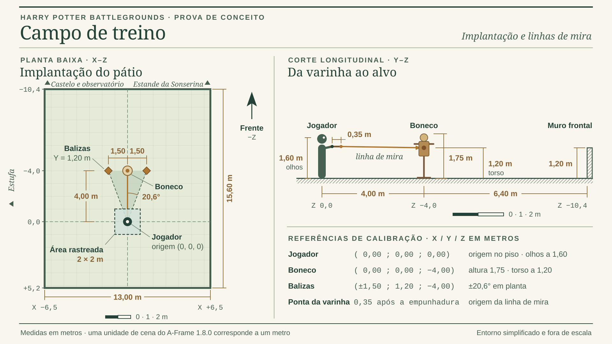
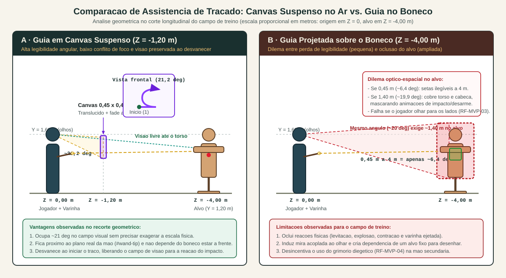
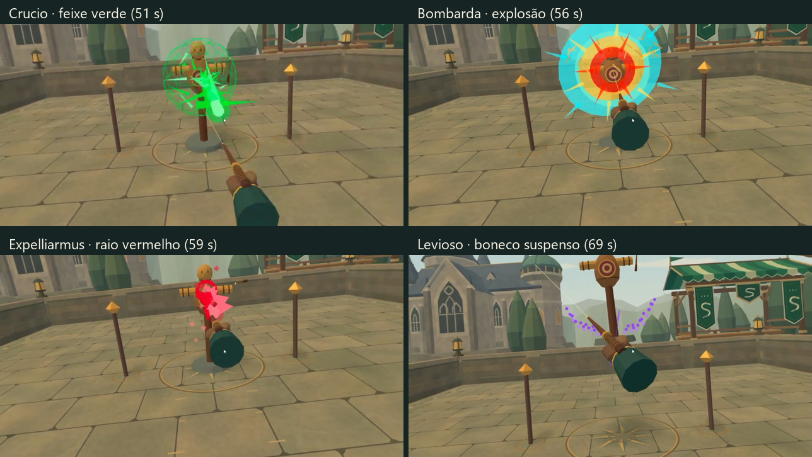

# Game Design Document (GDD) — Harry Potter Battlegrounds

## Introdução

Harry Potter Battlegrounds é um projeto da Eletiva de Experiências Imersivas do Inteli (2026). Este documento especifica o campo de treino, os requisitos do produto mínimo viável (MVP) e as mecânicas de duelo previstas para depois da validação do treino. Os ensaios da Semana 2 registram quais partes da conjuração funcionaram no computador e no Meta Quest 3. [Ficha do Projeto](ficha-do-projeto.md)

## Sumário

- [1. Visão Geral e Recorte de Escopo](#1-visão-geral-e-recorte-de-escopo)
  - [1.1. Conceito Central (*High Concept*)](#11-conceito-central-high-concept)
  - [1.2. Escopo do MVP — Campo de Treinamento](#12-escopo-do-mvp--campo-de-treinamento)
  - [1.3. Diretriz de Priorização e Evolução Incremental](#13-diretriz-de-priorização-e-evolução-incremental)
  - [1.4. Inspirações e Referências](#14-inspirações-e-referências)
  - [1.5. Planta, corte e calibração](#15-planta-corte-e-calibração)
- [2. Mecânicas Centrais do MVP (*Core Loop*)](#2-mecânicas-centrais-do-mvp-core-loop)
  - [2.1. Conjuração por Movimento da Varinha (Desenho do Feitiço)](#21-conjuração-por-movimento-da-varinha-desenho-do-feitiço)
  - [2.2. Alvo de Treinamento (Boneco de Palha) e Reações Específicas](#22-alvo-de-treinamento-boneco-de-palha-e-reações-específicas)
  - [2.3. Grimório Diegético na Mão Secundária](#23-grimório-diegético-na-mão-secundária)
  - [2.4. Posicionamento e Controle Base](#24-posicionamento-e-controle-base)
  - [2.5. Pesquisa e reconhecimento do traçado](#25-pesquisa-e-reconhecimento-do-traçado)
- [3. Backlog de Evolução (Funcionalidades Pós-MVP)](#3-backlog-de-evolução-funcionalidades-pós-mvp)
  - [3.1. Combinação e Criação de Feitiços e Interação entre Opositores](#31-combinação-e-criação-de-feitiços-e-interação-entre-opositores)
  - [3.2. Mobilidade e Defesa de Combate (*Dash*, *Protego* e Esquiva Física)](#32-mobilidade-e-defesa-de-combate-dash-protego-e-esquiva-física)
  - [3.3. Recursos de Combate (Medidores de Vida, *Protego* e *Dash*)](#33-recursos-de-combate-medidores-de-vida-protego-e-dash)
  - [3.4. Interação Ambiental de Arena](#34-interação-ambiental-de-arena)
  - [3.5. Modo de Batalha em Tempo Real (PvP e PvE)](#35-modo-de-batalha-em-tempo-real-pvp-e-pve)
- [4. Matriz de Requisitos e Priorização](#4-matriz-de-requisitos-e-priorização)
  - [4.1. Requisitos Funcionais do MVP (Prioridade Alta — Escopo Atual)](#41-requisitos-funcionais-do-mvp-prioridade-alta--escopo-atual)
  - [4.2. Requisitos do Backlog (Prioridade Secundária — Expansão Futura)](#42-requisitos-do-backlog-prioridade-secundária--expansão-futura)
- [5. Entrega 02 e registro da Semana 2](#5-entrega-02-e-registro-da-semana-2)
  - [5.1. Critérios de aceitação](#51-critérios-de-aceitação)
  - [5.2. Resultados no computador](#52-resultados-no-computador)
  - [5.3. Ensaios no Quest físico](#53-ensaios-no-quest-físico)
  - [5.4. Demonstração de cinco minutos](#54-demonstração-de-cinco-minutos)
- [6. Referências da pesquisa de traçado](#6-referências-da-pesquisa-de-traçado)
- [Conclusão](#conclusão)

---

## 1. Visão Geral e Recorte de Escopo

### 1.1. Conceito Central (*High Concept*)

**Harry Potter Battlegrounds** é uma experiência imersiva em primeira pessoa em que o jogador traça feitiços no ar com uma varinha, pronuncia palavras de conjuração e aponta a varinha para lançar feitiços e observar suas reações no ambiente virtual.

### 1.2. Escopo do MVP — Campo de Treinamento

Para garantir profundidade técnica e solidez na mecânica principal antes da introdução de sistemas competitivos complexos, o escopo inicial do projeto concentra-se integralmente no **Campo de Treino (*Training Ground*)**:

- **Cenário Controlado:** Um ambiente de treinamento fechado ou delimitado, estruturado para calibração de gestos, leitura espacial e feedback sensorial imediato.
- O pátio mede **13 × 15,6 m**, um acréscimo de 30% na largura e na profundidade sobre a planta de 10 × 12 m. O topo do castelo e o estande da Sonserina integram a composição do perímetro. O corredor de mira até o boneco permanece livre.
- **Alvo Dedicado (Boneco de Palha):** Um boneco de palha (*training dummy*) posicionado à frente do jogador funciona como receptor principal das magias lançadas.
- **Disposição do campo na prova de conceito:** O jogador inicia no centro da área de partida, com o boneco a 4 m à frente e uma baliza a 1,50 m de cada lado do alvo. Essa disposição permite observar se a mira permanece no peito do boneco quando o jogador olha para uma baliza. A escala percebida e o alinhamento da empunhadura serão verificados no visor. [Planta, corte e calibração](#15-planta-corte-e-calibração)
- **Ciclo Principal (*Core Loop*):**
  1. O jogador consulta ou recorda o traçado do feitiço desejado.
  2. Desenha o movimento específico no espaço com a varinha na mão dominante e pronuncia as palavras de conjuração.
  3. Lança o feitiço a partir da ponta da varinha, na direção em que ela estiver apontada.
  4. O boneco de palha apresenta uma resposta física e visual compatível com o feitiço acertado, permitindo ao jogador validar precisão e efeito.

### 1.3. Diretriz de Priorização e Evolução Incremental

A estratégia de entrega adota construção incremental sobre uma base validada: primeiro consolida-se a captura confiável do movimento da varinha, o disparo direcionado e as reações distintas no boneco de palha; somente após a estabilização desse núcleo passam a ser incorporados os módulos de duelo em tempo real, defesa ativa, mobilidade tática, criação/combinação avançada de feitiços e suporte *multiplayer* listados na Seção 3.

### 1.4. Inspirações e Referências

O boneco suspenso de *Hogwarts Legacy* orienta a leitura do impacto. *War of Wizards* inspira o rastro no ar, *Mage Arena* situa o grimório no campo de visão e *Waltz of the Wizard* associa a voz à reação do ambiente. O pátio de pedra e as balizas de latão enquadram os feitiços de cores distintas. As imagens, os créditos, os estudos de gesto e a paleta estão no [moodboard do campo de treino](moodboard.md).

### 1.5. Planta, corte e calibração

A cena usa metros. A origem fica no piso, sob o jogador. O eixo +Y aponta para cima, +X para a direita e −Z para a frente. Na planta, cada quadrícula representa 1 m. O quadrado tracejado de 2 × 2 m indica a área física de referência. O corte mantém a mesma escala nos eixos vertical e longitudinal. [Vista do pátio no computador](assets/patio-campo-pc.png)

| Elemento | Posição ou medida na cena |
| --- | --- |
| Piso do pátio | 13 × 15,6 m. Em X, de −6,50 a +6,50 m. Em Z, de −10,40 a +5,20 m. O muro frontal tem altura nominal de 1,20 m e fica 6,40 m além do boneco. |
| Jogador e cabeça | `#player-rig` começa em (0, 0, 0). A câmera fica a 1,60 m no computador. Em WebXR, o visor fornece a pose dos olhos. |
| Varinha | No computador, a mão parte de X = ±0,25 m, Y = 1,15 m e Z = −0,40 m. No visor, acompanha o controle escolhido. A ponta fica 0,35 m à frente da empunhadura. |
| Boneco | A base está em X = 0, Y = 0 e Z = −4 m. A altura nominal é 1,75 m e o centro do peito fica a 1,20 m do piso. |
| Balizas | Os centros dos octaedros ficam em X = ±1,50 m, Y = 1,20 m e Z = −4 m. Vistos da origem, formam ângulos de ±20,6° com o eixo frontal em planta. |

Na hierarquia de entidades do A-Frame, a câmera (`#head`) e a mão (`#wand-hand`) são filhas de `#player-rig`. A linha de mira (`#aim-ray`) parte de `#wand-tip` e se estende por 8 m no eixo −Z local. Essa disposição permite observar uma baliza enquanto a varinha continua apontada para o peito do boneco. As dimensões do piso vêm da malha do pátio e as posições das entidades, da cena. [Modelo do pátio](../src/assets/models/patio-de-treino.glb) · [Cena A-Frame](../src/index.html)

A calibração no visor considera o alinhamento do piso virtual com o chão, o ângulo de empunhadura e a leitura do impacto a 4 m. Para a futura locomoção por joystick, o planejamento reserva 0,50 m junto às laterais e ao fundo e 0,80 m junto ao muro frontal. Essa margem e a posição proposta para a guia de traçado são reservas de projeto externas ao desenho da planta.

---

## 2. Mecânicas Centrais do MVP (*Core Loop*)

### 2.1. Conjuração por Movimento da Varinha (Desenho do Feitiço)

A versão imersiva do MVP exige o controle físico do Quest na mão selecionada para a varinha. A interação com a varinha fica suspensa enquanto o controle estiver desconectado ou sem uma pose rastreada. O visor informa qual controle deve ser ativado e a interação é retomada quando o rastreamento é restabelecido.

O menu de mão dominante pode ser reaberto durante o treino pelo botão de menu do controle esquerdo, com o botão Y esquerdo como alternativa. O gatilho da mão escolhida confirma a troca na mesma sessão.

A entrada principal do MVP baseia-se no reconhecimento geométrico e cinemático do movimento do controle que representa a varinha.

**Regra de conjuração.** Todo feitiço exige o uso da varinha para traçar o padrão correspondente e efetuar o lançamento.

1. **Desenho Gestual:** O jogador traça o padrão específico correspondente a cada feitiço utilizando o controle físico na mão da varinha.
2. **Comando de Voz:** O MVP reconhece as palavras pronunciadas pelo jogador e as associa ao feitiço correspondente durante a conjuração. A prova de conceito de 27/11 dispensa a voz. O reconhecimento de voz está previsto para a Semana 3 do projeto.
3. **Mira:** A direção inicial de lançamento segue uma linha que parte da ponta da varinha e acompanha a orientação da varinha no momento do lançamento. A câmera acompanha a cabeça de forma independente da mira.
4. **Lançamento:** Ao soltar o gatilho que encerra o desenho, o feitiço reconhecido fica preparado na ponta da varinha. O jogador aponta e aperta o **Grip** (botão lateral da empunhadura, acionado pelo dedo médio) para lançar. O Grip é o comando de lançamento oficial da prova de conceito de 27/11.
5. **Colisão com o cenário:** O feitiço termina no primeiro elemento sólido que cruza sua trajetória: boneco, balizas, muros, piso ou estruturas do pátio. Fora do boneco, o contato produz um efeito de impacto na cor do feitiço. *Bombarda* explode no ponto de contato. O boneco só reage quando é o primeiro elemento atingido.
6. **Feedback de Conjuração:** Ao reconhecer o traçado válido e atender às condições de conjuração, o sistema emite o efeito visual e sonoro da magia na ponta da varinha e projeta o feitiço na direção indicada pela mira.

> [!NOTE]
> Os quatro nomes de conjuração estão na seção 2.2. Os padrões gestuais e as tolerâncias de reconhecimento serão calibrados no campo.

A apresentação visual da mira está descrita no [eixo Moldura da Ficha do Projeto](ficha-do-projeto.md#moldura).

### 2.2. Alvo de Treinamento (Boneco de Palha) e Reações Específicas

O boneco de palha atua como ponto focal de validação das mecânicas do MVP, devendo responder de forma diferenciada e legível a cada feitiço implementado:

- **Reações Físicas:** Oscilação por impacto, repulsão, queda ou estabilização após o golpe.
- **Reações Elementais e de Estado:** Efeitos visuais específicos na superfície ou estrutura do boneco (por exemplo, combustão/chamuscamento, congelamento, atordoamento ou marcas de energia mágica), garantindo que movimentos diferentes causem consequências perceptivelmente distintas.

A prova de conceito adapta quatro efeitos da obra ao boneco de palha. Cada resposta tem um sinal observável em primeira pessoa.

| Feitiço e efeito de referência | Resposta na prova de conceito | O que observar no ensaio |
| --- | --- | --- |
| **Levioso** ergue o alvo e o mantém suspenso no ar. [Guia de Hogwarts Legacy](https://www.powerpyx.com/hogwarts-legacy-all-spells-guide/) | Ao ser atingido, o boneco de palha sobe cerca de 1,50 m sob uma aura roxa, permanece brevemente suspenso e retorna à posição inicial. | A subida, a suspensão e o retorno são visíveis em primeira pessoa. Ao errar o boneco, ele permanece na posição inicial. |
| **Bombarda** provoca uma pequena explosão no objeto atingido. [Enciclopédia oficial](https://www.harrypotter.com/fact-file/spells/the-bombardment-spell) | No ponto de impacto, um anel se expande, palha se dispersa e o torso recua na base. | A explosão nasce no ponto acertado. Ao errar o boneco, ele permanece imóvel. |
| **Expelliarmus** desarma o oponente. [Enciclopédia oficial](https://www.harrypotter.com/fact-file/spells/the-disarming-charm) | Um feixe vermelho alcança o boneco. Uma varinha de treino se desprende da mão dele, gira em arco e cai ao lado da base. | A mão do alvo fica vazia. A varinha do jogador continua disponível. O acessório retorna ao boneco após cerca de 2,5 s. |
| **Crucio** provoca dor intensa no alvo. [Enciclopédia oficial](https://www.harrypotter.com/fact-file/spells/the-cruciatus-curse) | Um feixe verde com espinhos atinge o torso. O boneco sofre espasmos por cerca de 2 s e a marca se dissipa após o feixe. | O boneco reage no lugar. Os espasmos e a marca temporária distinguem o efeito da explosão única de Bombarda. |

Na PoC, o rastro torna visível o gesto e a cor na ponta confirma o preparo. Após a recuperação do boneco, a conjuração pode ser repetida. A captura do nome por voz está prevista para a Semana 3.

### 2.3. Grimório Diegético na Mão Secundária

Na mão oposta à que empunha a varinha, o jogador carrega um **grimório aberto** como elemento diegético de auxílio:

- **Guia Visual de Traçado:** As páginas exibem os movimentos específicos exigidos para desenhar cada feitiço disponível no campo de treinamento.
- **Troca Livre de Páginas:** O jogador pode folhear o grimório para consultar diferentes feitiços a qualquer momento.
- **Conjuração Desacoplada:** A execução de um feitiço não fica condicionada à página aberta; o jogador pode desenhar e lançar qualquer feitiço conhecido independentemente da página exibida no momento.

### 2.4. Posicionamento e Controle Base

O deslocamento pelo campo de treinamento ocorre por meio do *joystick* para ajuste de distância e ângulo em relação ao boneco de palha, mantendo a câmera em primeira pessoa alinhada à movimentação física natural da cabeça no ambiente imersivo.

---

### 2.5. Pesquisa e reconhecimento do traçado

O estudo de *kanji* e *hanzi* motivou a decomposição do símbolo em segmentos com sentido definido. A caligrafia virtual sobre uma superfície também explora a resposta do pincel ao contato. No campo de treino, a mão desenha livremente no ar. O rastro luminoso permite acompanhar o gesto enquanto o alvo permanece visível. [Referências da pesquisa](#6-referências-da-pesquisa-de-traçado)

Ao pressionar o gatilho, o sistema fixa um plano vertical definido pelo eixo horizontal da visão naquele instante e pela vertical do mundo. O reconhecedor projeta nele a trajetória da ponta, a reamostra em **40 pontos equidistantes ao longo do percurso**, centraliza os pontos e normaliza a escala preservando as proporções. A comparação considera a distância ao modelo e o sentido dos segmentos, na orientação original, **sem aplicar rotação**. Se o melhor modelo se afasta do gesto ou dois modelos obtêm resultados muito próximos, o jogador recebe uma indicação de falha e pode tentar novamente. O modo de mesa reutiliza esse reconhecedor. [Componente de traçado](../src/js/components/tracado-varinha.js)

**Assistência visual.** Uma guia de 0,45 m de largura ocupa aproximadamente 21,2° a 1,20 m dos olhos e 6,4° sobre o boneco a 4 m. Para ocupar cerca de 20° junto ao alvo, precisaria medir aproximadamente 1,40 m e encobriria parte da reação. A PoC mantém o corredor de mira livre. A alternativa proposta para prática guiada é um símbolo translúcido suspenso a 1,20 m que desaparece ao iniciar o desenho. O grimório permanece como consulta prevista no MVP.

**Ergonomia do disparo.** O último segmento de *Expelliarmus* aponta para baixo. Separar o fim do desenho do lançamento permite reconduzir a varinha até o alvo. Soltar o gatilho prepara o feitiço e o Grip efetua o disparo. A implementação também aceita um toque no gatilho com duração inferior a 220 ms e percurso inferior a 0,10 m. Um novo desenho substitui a magia preparada. Abrir o menu ou perder a pose do controle cancela o preparo e exige a soltura dos botões antes de reiniciar.

---

## 3. Backlog de Evolução (Funcionalidades Pós-MVP)

As funcionalidades a seguir compõem a visão expandida do projeto e permanecem preservadas em *backlog*, com implementação condicionada à conclusão prévia do MVP e à disponibilidade de tempo no cronograma da disciplina.

### 3.1. Combinação e Criação de Feitiços e Interação entre Opositores

- **Combinação e Criação de Feitiços:** Capacidade de combinar os efeitos de mais de um feitiço simultaneamente ou compor variações mágicas a partir de propriedades acumuladas.
- **Arsenal Multicategoria:** Expansão dos feitiços para além do ataque direto, incorporando categorias dedicadas a defesa, mobilidade e aplicação de efeitos táticos diversos.
- **Interação entre Feitiços Opositores:** Resolução sistêmica quando feitiços de naturezas contrárias colidem em trajetória (por exemplo, um feitiço de fogo sendo apagado ao ser interceptado por um feitiço de água).

### 3.2. Mobilidade e Defesa de Combate (*Dash*, *Protego* e Esquiva Física)

- ***Dash* Lateral:** Manobra rápida de deslocamento lateral para evasão de projéteis e reposicionamento em duelo.
- **Esquiva Física de Cabeça:** Desvio corporal físico do jogador no espaço rastreado para evitar ataques direcionados à altura da cabeça, enquanto o *joystick* controla a locomoção geral do corpo.
- **Feitiço de Proteção (*Protego*) e Recarga Ativa:** Escudo defensivo com limite máximo de utilizações consecutivas; ao ultrapassar esse limite, entra em tempo de recarga (*cooldown*). Acertar feitiços no oponente reduz ativamente o tempo restante de recarga do *Protego*.

### 3.3. Recursos de Combate (Medidores de Vida, *Protego* e *Dash*)

Para sustentar duelos competitivos, a interface passará a incluir três medidores operacionais dedicados:

| Medidor | Finalidade no Backlog |
| :--- | :--- |
| **Medidor de Vida** | Controle de integridade dos duelistas e condição de vitória/derrota em batalha. |
| **Medidor de *Protego* (Escudo)** | Controle de cargas restantes de proteção e contagem regressiva de *cooldown*. |
| **Medidor de *Dash*** | Controle de disponibilidade para execução do *dash* lateral. |

### 3.4. Interação Ambiental de Arena

Evolução do cenário de treinamento estático para arenas interativas em que os feitiços afetam elementos estruturais contra o adversário:

- **Derrubada de Pilastras:** Colapso físico de estruturas para bloquear linhas de visão ou atingir o oponente.
- **Queima de Estruturas:** Propagação de fogo em elementos inflamáveis do local.
- **Alteração de Terreno:** Modificação do piso para tornar áreas difíceis de navegar e restringir o deslocamento inimigo.

### 3.5. Modo de Batalha em Tempo Real (PvP e PvE)

Adição do **Modo de Batalha** sobre a base do sistema de conjuração, contemplando duas modalidades de confronto em tempo real:

- **Jogador vs. Jogador (PvP / *Multiplayer*):** Duelos em rede ou arena compartilhada entre dois participantes.
- **Jogador vs. CPU (PvE):** Duelos contra oponente controlado por inteligência artificial.

---

## 4. Matriz de Requisitos e Priorização

### 4.1. Requisitos Funcionais do MVP (Prioridade Alta — Escopo Atual)

| ID | Requisito Funcional | Critério de Verificação |
| :--- | :--- | :--- |
| **RF-MVP-01** | Campo de Treinamento com boneco de palha | O jogador inicia em um cenário de treinamento contendo um boneco de palha posicionado à sua frente como alvo funcional. |
| **RF-MVP-02** | Desenho e reconhecimento do movimento da varinha | Na versão imersiva, o sistema exige um traçado válido obtido do controle físico da mão selecionada para identificar e lançar o feitiço. |
| **RF-MVP-03** | Lançamento direcionado e reação específica no alvo | O feitiço parte da ponta da varinha na direção em que ela aponta, inclusive quando o jogador olha para outro ponto, e é lançado pelo Grip. Ao atingir o boneco de palha, desencadeia a reação física e visual associada. Um obstáculo do cenário no caminho interrompe o feitiço no ponto de contato, sem reação no boneco. |
| **RF-MVP-04** | Grimório diegético com troca livre de páginas | A mão secundária exibe o grimório aberto com os movimentos de cada feitiço e permite trocar páginas livremente, sem impedir a conjuração de feitiços de outras páginas. |
| **RF-MVP-05** | Locomoção base no campo de treino | O jogador movimenta o personagem pelo campo de treinamento por meio do *joystick* em visão em primeira pessoa. |
| **RF-MVP-06** | Reconhecimento de voz na conjuração | Durante a conjuração, o sistema reconhece as palavras pronunciadas pelo jogador e as associa ao feitiço correspondente. Previsto para a Semana 3. |

### 4.2. Requisitos do Backlog (Prioridade Secundária — Expansão Futura)

| ID | Requisito Funcional | Critério de Verificação |
| :--- | :--- | :--- |
| **RF-BKL-01** | Categorias estendidas, criação e combinação de feitiços | O sistema suporta feitiços de defesa, mobilidade e controle, além da combinação simultânea ou criação de efeitos compostos entre múltiplas magias. |
| **RF-BKL-02** | Colisão entre feitiços opositores | Feitiços de propriedades contrárias interagem ao se interceptarem (ex.: feitiço de água apaga feitiço de fogo). |
| **RF-BKL-03** | *Dash* lateral e esquiva física de cabeça | O jogador executa *dash* lateral pelo controle e evita ataques direcionados à cabeça por meio do deslocamento físico real. |
| **RF-BKL-04** | Sistema *Protego* com limite e recarga ativa | O escudo entra em *cooldown* ao exceder seu limite de usos e tem o tempo restante reduzido a cada feitiço acertado no oponente. |
| **RF-BKL-05** | Medidores de combate e destrutibilidade de arena | A interface exibe os medidores de Vida, *Protego* e *Dash*; feitiços aplicados ao cenário derrubam pilastras, queimam estruturas e dificultam a navegação do terreno. |
| **RF-BKL-06** | Modo de Batalha em tempo real (PvP e PvE) | O jogo disponibiliza confrontos em tempo real selecionáveis entre **Jogador vs. Jogador (*Multiplayer*)** e **Jogador vs. CPU**. |

## 5. Entrega 02 e registro da Semana 2

Em 27 de novembro de 2026, a prova de conceito reunia desenho, preparo, mira, disparo e reação ao primeiro contato. O pátio ampliado preservou o corredor de 4 m até o boneco. O modo de mesa passou a compartilhar os quatro gestos e efeitos da sessão imersiva. O reconhecimento de voz, o grimório e a locomoção por joystick pertencem às etapas seguintes do MVP.

### 5.1. Critérios de aceitação

| Ensaio | Condição para avançar |
| --- | --- |
| Entrada e escala | O menu permite escolher a mão. O jogador vê o piso, as duas balizas e o boneco. O piso virtual coincide com o chão percebido. |
| Controle obrigatório | A perda de rastreamento desativa a varinha e identifica a mão a reativar. O retorno da pose restabelece a mira e exige um novo traçado para armar o disparo. |
| A · Girar só a cabeça | Com a mão imóvel e a varinha no peito do boneco, olhar para a baliza esquerda preserva o ponto de mira. |
| B · Girar só a mão | Com a cabeça voltada para o boneco, girar a mão leva a linha do peito até a baliza direita e de volta, com o enquadramento estável. |
| Conjuração e colisão | Os quatro símbolos preparam feitiços distintos. O Grip lança na direção da ponta. Um acerto produz a reação da seção 2.2 e permite repetir após a recuperação. Um obstáculo no caminho recebe o impacto e o boneco permanece imóvel. |

O parecer sobre a mira depende dos ensaios A e B em primeira pessoa. A aprovação integral de entrada, escala e controle depende de observar também o piso e a retomada no dispositivo. Uma falha requer registrar a condição, corrigir a causa e repetir o ensaio correspondente.

### 5.2. Resultados no computador

- **Mira e mesa.** No Chrome 159 para Windows, os ensaios A e B passaram com as duas mãos. Em 26/11, o mouse foi usado para desenhar os quatro símbolos. Com a câmera girada cerca de 18°, Espaço, botão do painel e clique direito dispararam a partir da ponta, com desvio inferior a 1 mm na origem medida. [Cabeça voltada à baliza](assets/poc-cabeca-pc.png) · [Punho voltado à baliza](assets/poc-punho-pc.png) · [Modo de mesa](assets/poc-modo-mesa-pc.png)
- **WebXR emulado.** No perfil Quest 3 do IWER 2.8.0, os quatro feitiços acertaram o peito com a cabeça girada cerca de 33°. Passaram os disparos por Grip e toque, o retorno do boneco, a rejeição do traçado inválido, a substituição do feitiço e o cancelamento por menu, perda de pose ou saída de VR. A reconexão restituiu a varinha. [Quatro conjurações no computador](assets/poc-quatro-feiticos-pc.png)
- **Primeiro contato, 27/11.** Bombarda explodiu na baliza esquerda, próximo de X = −1,46 m, Y = 1,20 m e Z = −3,92 m. Os ensaios também registraram impactos no muro lateral, em X ≈ ±6,28 m, e no piso, em Y ≈ 0. O boneco permaneceu imóvel quando havia um obstáculo no trajeto. [Impacto na baliza](assets/poc-colisao-baliza-pc.png)

### 5.3. Ensaios no Quest físico

| Data | Observação no dispositivo |
| --- | --- |
| 24–25/11 | No primeiro teste, cabeça, varinha e mira responderam, mas o piso e o menu ficaram invisíveis. Em 25/11, o pátio e o menu de seleção da mão apareceram no visor. |
| 26/11 | A gravação de 88 s no Meta Quest 3, com o controle direito, registrou a escolha da mão, a reabertura do menu pelo Y esquerdo e as quatro conjurações pelo Grip. O participante aprovou os ensaios A e B com base na gravação. |
| 27/11 | O participante confirmou no visor que o cenário interrompe o disparo. As coordenadas de impacto da seção 5.2 foram medidas no computador. |

Na gravação, o menu aparece aos 13 s, a linha cruza o peito entre 17 e 23 s e o menu reabre entre 25 e 29 s. Os impactos ocorrem na sequência *Crucio* (48–51 s), *Bombarda* (55–56 s), *Expelliarmus* (58–59 s) e *Levioso* (67–70 s). Aos 76,5 s, o visor pede a reativação do controle direito. O retorno da mira após a reconexão e a aferição do alinhamento do piso ainda precisam de registro no visor. A versão instalada do Meta Quest Browser também ficou sem leitura direta.

[Menu imersivo](assets/poc-quest-menu.png) · [Mira e aviso do controle](assets/poc-quest-mira-controle.png) · [Traçado e preparo de Crucio](assets/poc-quest-tracado-armado.png)

### 5.4. Demonstração de cinco minutos

| Tempo | O que demonstrar |
| --- | --- |
| 0:00–0:40 | Com a cena carregada e o visor espelhado, entrar em VR, identificar os quatro símbolos e escolher a mão pelo gatilho. |
| 0:40–1:25 | Preparar *Levioso*, mirar no peito, olhar para a baliza esquerda e disparar pelo Grip. Observar a suspensão e o retorno. |
| 1:25–2:45 | Lançar *Bombarda* e *Crucio*. Observar a diferença entre o impacto único com recuo e o feixe que provoca espasmos. |
| 2:45–3:30 | Terminar *Expelliarmus* com o traço para baixo, apontar de novo para o peito e desarmar o boneco. |
| 3:30–4:15 | Lançar *Bombarda* contra a baliza e localizar a explosão enquanto o boneco permanece imóvel. |
| 4:15–5:00 | Apresentar um quadro do ensaio físico, a [prancha visual](moodboard.md) e a [planta com o corte](#15-planta-corte-e-calibração). |

## 6. Referências da pesquisa de traçado

- Patha Pradipa. *You, Calligrapher*. LuciiDream, 2021. Prática de caligrafia chinesa com pincel virtual. [Página do projeto na Steam](https://store.steampowered.com/app/1593700/You_Calligrapher/)
- Wu, Y., Yuan, Z., Zhou, D. e Cai, Y. *Research of virtual Chinese calligraphic learning*. IEEE International Conference on Multimedia and Expo, 2013. [DOI 10.1109/ICME.2013.6607439](https://doi.org/10.1109/ICME.2013.6607439)
- Liang, C.-W., Hsieh, M.-C. e Young, K.-Y. *A VR-based Calligraphy Writing System with Force Reflection*. International Journal of Automation and Smart Technology, v. 1, n. 2, 2011, p. 83–91. [DOI 10.5875/ausmt.v1i2.90](https://doi.org/10.5875/ausmt.v1i2.90)
- Bussiere, R. *O.K. Origin Kanji*. Aplicativo de consulta à origem visual e aos componentes dos caracteres japoneses no Meta Horizon OS. [Descrição do autor](https://devpost.com/software/o-k-origin-kanji)

## Conclusão

A Entrega 02 demonstrou que o jogador consegue desenhar um símbolo, reconhecer o preparo na ponta e atingir o boneco mesmo olhando para uma baliza. A separação entre traçado e disparo preservou a direção da mão nos quatro feitiços. O cenário também passou a interromper a magia no primeiro contato. A próxima etapa é associar a palavra pronunciada ao gesto. A retomada do controle e o alinhamento do piso ainda requerem registro físico antes de encerrar a calibração do campo.
