# Moodboard do campo de treino

## Introdução

O pátio de pedra, as balizas de latão e o boneco de palha formam um fundo estável para acompanhar o desenho no ar, a cor na ponta da varinha e a reação do alvo.

[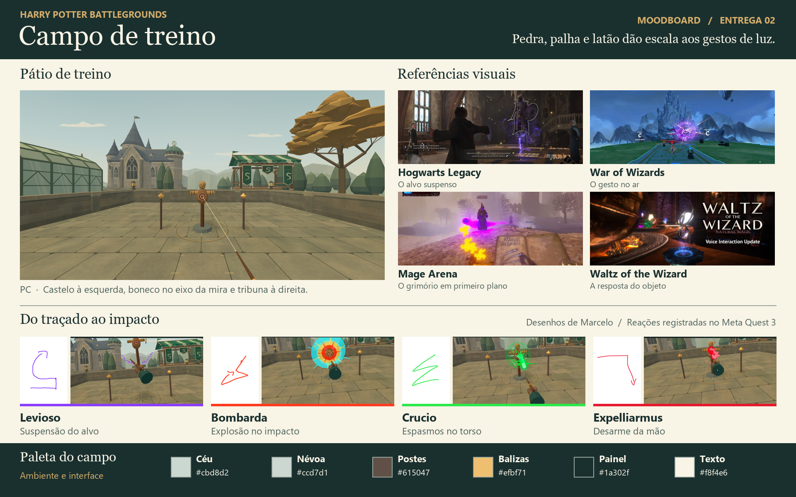](assets/moodboard/prancha-campo-de-treino.png)

[Abrir a prancha em tamanho integral](assets/moodboard/prancha-campo-de-treino.png) · [Consultar a planta e o corte do campo](gdd.md#15-planta-corte-e-calibração)

## Referências de direção visual

Cada referência orienta uma escolha visível no campo de treino ou prevista para o grimório e a voz no MVP. [GDD, seção 1.4](gdd.md#14-inspirações-e-referências)

| Referência | Intenção visual | Imagem e crédito |
| --- | --- | --- |
| *Hogwarts Legacy* | A distância entre o boneco suspenso e o piso torna a levitação reconhecível. | [Captura da aula](assets/moodboard/ref-hogwarts-legacy.jpg) · [ActuGaming](https://www.actugaming.net/soluce-cours-defense-forces-mal-hogwarts-legacy-544187/) |
| *War of Wizards* | O rastro luminoso ocupa o espaço entre a mão e o alvo, deixando o gesto visível durante o desenho. | [Captura da arena](assets/moodboard/ref-war-of-wizards.jpg) · [Galeria do jogo na Steam](https://store.steampowered.com/app/2009460/War_of_Wizards/) |
| *Mage Arena* | O grimório aberto abaixo da linha de mira permite consultar o nome do feitiço com o alvo ainda à vista. | [Captura do grimório](assets/moodboard/ref-mage-arena.jpg) · [XboxPlay](https://xboxplay.games/mage-arena/how-to-get-more-spells-in-mage-arena-66020) |
| *Waltz of the Wizard* | O anel luminoso sobre o pedestal inspira uma resposta visível do objeto ao comando de voz. | [Imagem de divulgação da Aldin](assets/moodboard/ref-waltz-of-the-wizard.jpg) · [Publicação na UploadVR](https://www.uploadvr.com/waltz-of-the-wizard-voice-interactions/) |

## Estudos de gesto e efeito

As folhas de Marcelo aproximam o movimento da varinha da silhueta do efeito. As versões em PNG preservam os estudos completos, inclusive as variações manuscritas.

| Levioso · `#8b3dff` | Bombarda · `#ff3b1f` |
| --- | --- |
| [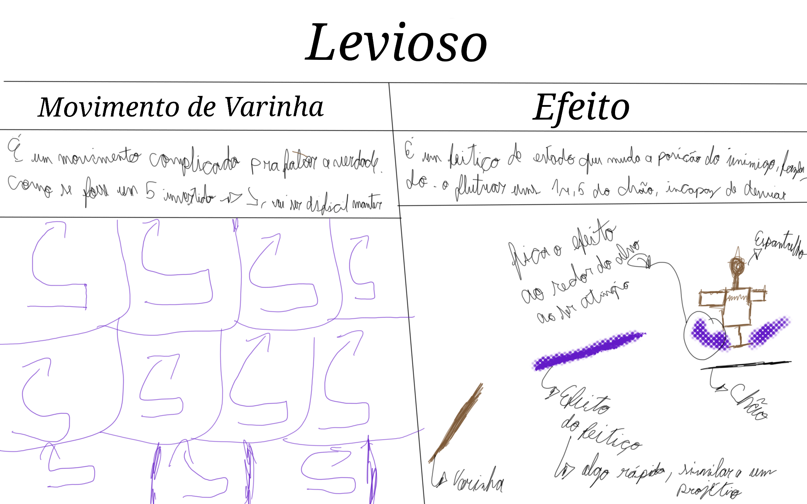](assets/moodboard/conceito-levioso.png) | [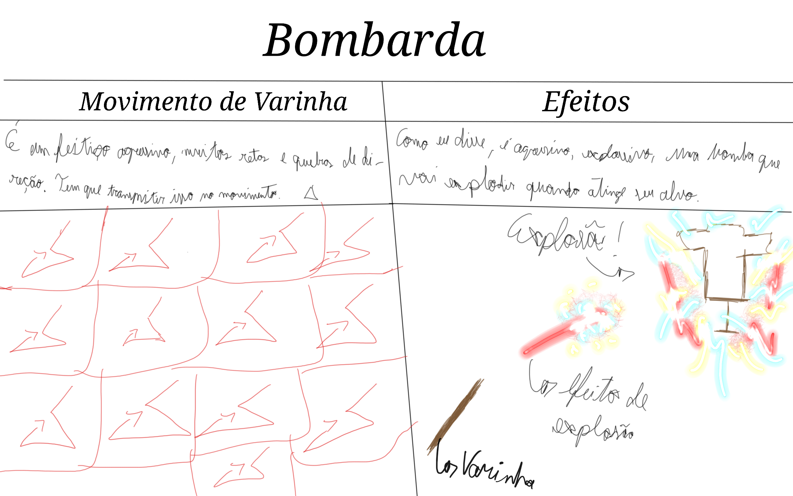](assets/moodboard/conceito-bombarda.png) |
| A curva termina para cima e a aura roxa acompanha a subida do boneco. | As mudanças bruscas de direção antecipam a explosão localizada. |

| Crucio · `#2be84a` | Expelliarmus · `#e6192e` |
| --- | --- |
| [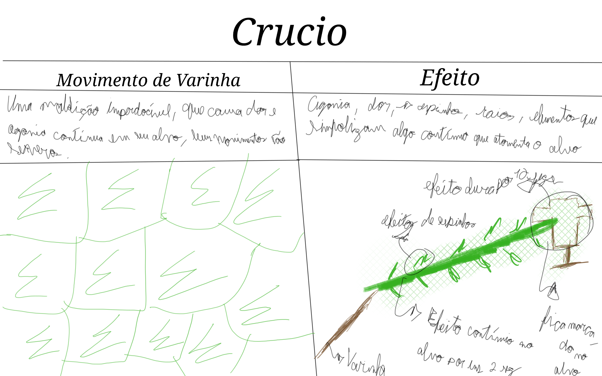](assets/moodboard/conceito-crucio.png) | [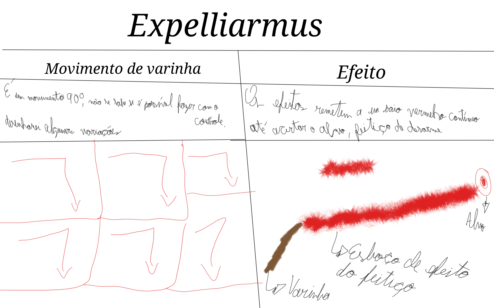](assets/moodboard/conceito-expelliarmus.png) |
| As quinas do zigue-zague reaparecem nos espinhos do feixe verde. | O gesto termina para baixo, e o raio vermelho conduz o olhar até a varinha que se solta da mão do boneco. |

A folha de Levioso corresponde ao arquivo de origem `ascendio.tiff`. [Desenhos originais](../src/assets/conceito-feitico/) · [Cores dos traçados](../src/js/components/tracado-varinha.js)

## O campo em uso

**Composição e impacto no computador.** O castelo e a tribuna enquadram o boneco. Na captura da direita, o clarão na baliza esquerda permite localizar um disparo fora do alvo.

| Vista inicial do pátio | Colisão de Bombarda com a baliza |
| --- | --- |
| [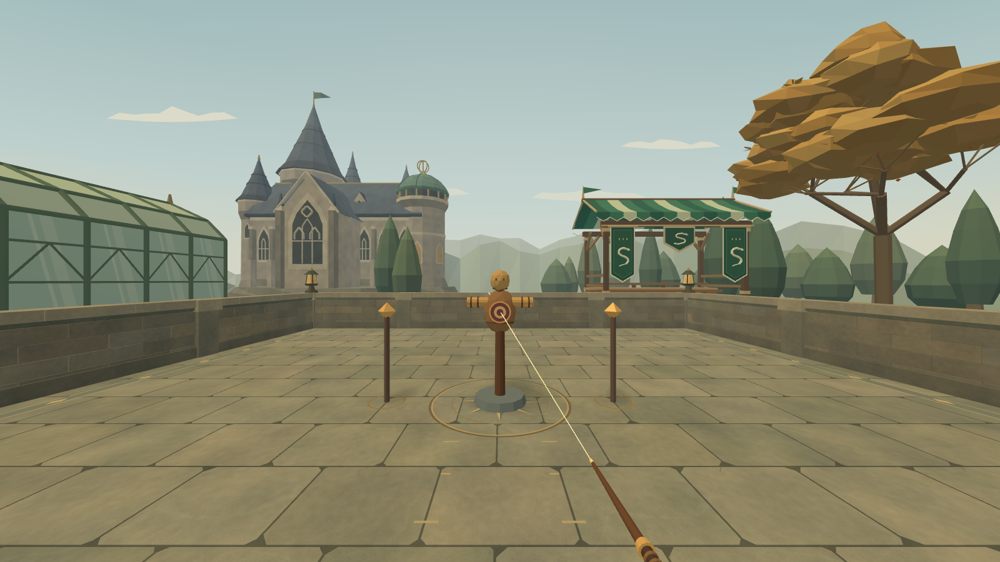](assets/patio-campo-pc.png) | [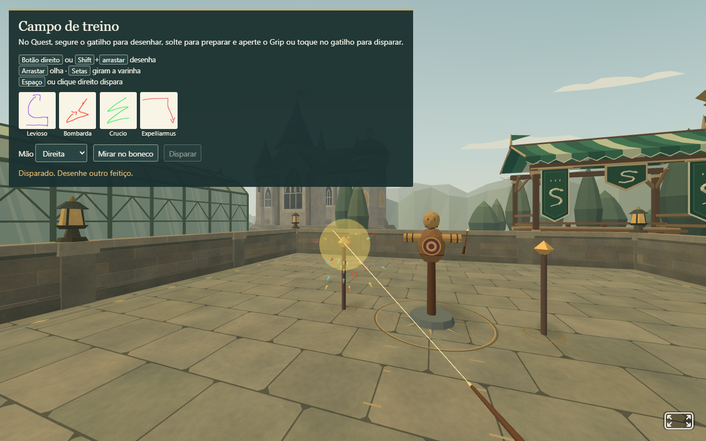](assets/poc-colisao-baliza-pc.png) |

**Leitura em primeira pessoa no Meta Quest 3.** Nos quadros da gravação de 26/11, a atenção passa dos símbolos no menu à mira junto à mão, à cor na ponta da varinha e ao impacto no boneco. [Registro do ensaio no visor](gdd.md#53-ensaios-no-quest-físico)

| Menu imersivo | Traço e preparo |
| --- | --- |
| [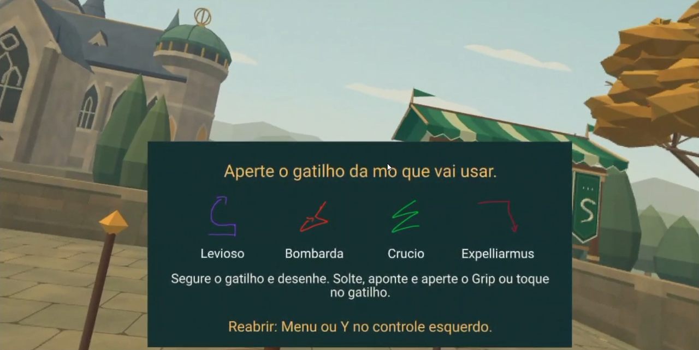](assets/poc-quest-menu.png) | [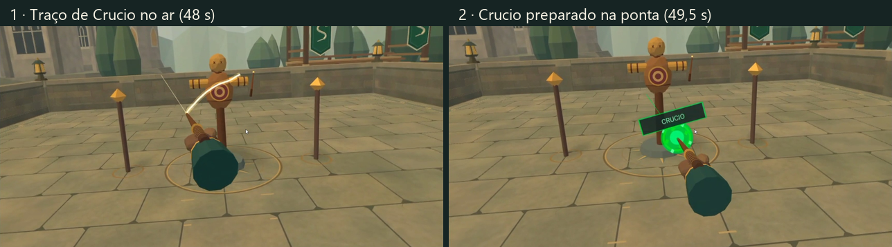](assets/poc-quest-tracado-armado.png) |

| Mira e aviso de controle | Quatro reações no alvo |
| --- | --- |
| [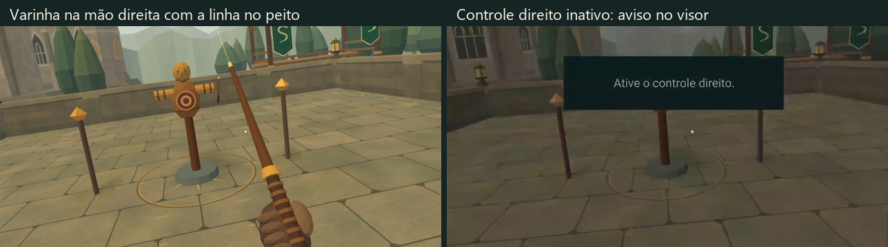](assets/poc-quest-mira-controle.png) | [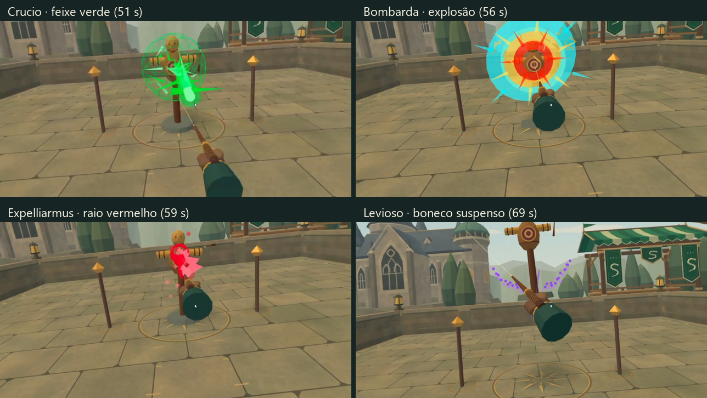](assets/poc-quest-quatro-feiticos.png) |

## Paleta de ambiente e interface

Os verdes acinzentados recuam no horizonte. O dourado aproxima as balizas e destaca as instruções, enquanto os quatro matizes dos feitiços identificam a conjuração preparada.

| Aplicação | Cores na implementação |
| --- | --- |
| Horizonte | Céu `#cbd8d2` e névoa `#ccd7d1` |
| Referências de mira | Postes `#615047`, balizas `#efbf71` e linha da varinha `#fff1ac` |
| Iluminação | Luz hemisférica `#fff1d4`, contribuição do solo `#9faeb2` e luz direcional `#ffe3ae` |
| Painel de treino | Fundo verde-escuro `#1a302ff2` (95% de opacidade), texto marfim `#f8f4e6` e filete dourado `#d3ac69` |
| Controles e estado | Botões `#294543`, bordas `#94a49b`, disparo disponível `#5a4424` e mensagem de estado `#efbf71` |

[Materiais e luzes da cena](../src/index.html) · [Cores do painel](../src/campo.css)

## Conclusão

Na vista inicial, o boneco entre as duas balizas oferece uma referência estável para a mira. Durante a conjuração, cada feitiço combina cor, trajetória e movimento do alvo. Mesmo quando os tons são próximos, a explosão de Bombarda e a varinha que se solta com Expelliarmus permitem distinguir os dois acertos. Essa distinção orienta a revisão dos efeitos no visor.
